# Carga 🏋️ — App de treino

> Aplicativo web (PWA) para organizar a semana de treinos, registrar as séries na academia, acompanhar a progressão de carga e a evolução do corpo, com um assistente de IA que monta o treino a partir de um pedido em texto ou voz.

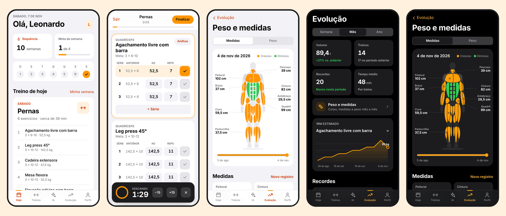

## Sumário

- [Sobre o projeto](#sobre-o-projeto)
- [Funcionalidades](#funcionalidades)
- [Telas](#telas)
- [Tecnologias](#tecnologias)
- [Como rodar](#como-rodar)
- [Banco de dados](#banco-de-dados)
- [Como funciona a progressão de carga](#como-funciona-a-progressão-de-carga)
- [Estrutura de pastas](#estrutura-de-pastas)
- [Próximos passos](#próximos-passos)
- [Autor](#autor)

---

## Sobre o projeto

A maioria dos apps de academia que eu testei ou é cheia de anúncio, ou não deixa montar o treino do jeito que eu faço, ou não mostra direito se eu estou evoluindo. Então resolvi fazer o meu.

A ideia do **Carga** é ser simples de usar no meio do treino (um toque para marcar a série, o timer de descanso começa sozinho) e, ao mesmo tempo, dar uma visão clara da evolução: quanto a carga subiu, quais recordes foram batidos e como as medidas do corpo mudaram ao longo dos meses.

O visual segue as diretrizes de design da Apple (Human Interface Guidelines): fundo neutro, uma única cor de destaque (laranja) e animações com efeito de mola. Tem tema **claro**, **escuro** e **automático**.

## Funcionalidades

**Conta**
- [x] Cadastro com nome, e-mail e senha
- [x] Login
- [x] "Esqueci minha senha" com link por e-mail e tela para criar uma senha nova

**Treinos**
- [x] Montar a própria semana: escolher o dia, dar nome ao treino e adicionar exercícios
- [x] Configurar séries, repetições (ex.: `8-12`), carga, descanso e uma nota por exercício
- [x] Biblioteca com **134 exercícios** em português, com busca e filtro por grupo muscular
- [x] Criar exercícios próprios quando não estão na lista
- [x] Reordenar e remover exercícios

**Treino ao vivo**
- [x] Séries já preenchidas com a carga sugerida e o que foi feito no treino anterior
- [x] Timer de descanso automático com vibração ao terminar (−15 s / +15 s / pular)
- [x] Calculadora de anilhas para exercícios com barra
- [x] Resumo no final com volume, séries, tempo e **recordes batidos**
- [x] Dá para sair e continuar o treino depois sem perder o que foi marcado

**Acompanhamento**
- [x] Check-in na academia, sequência de semanas e meta semanal
- [x] Sugestão automática de aumento de carga
- [x] Evolução por semana, mês e ano: volume, treinos, recordes e tempo médio
- [x] Gráfico do **1RM estimado** por exercício
- [x] Séries por grupo muscular na semana, com aviso quando está abaixo do ideal
- [x] Registro de **peso** em qualquer data (dá para lançar meses antigos) e histórico mês a mês
- [x] Registro de **medidas** com um **mapa muscular anatômico** que muda de cor e de tamanho conforme a evolução

**Assistente de IA**
- [x] Chat com o Claude (Anthropic) para tirar dúvidas de treino
- [x] Monta a semana inteira a partir de um pedido como *"treino ABC, 4x por semana, foco em pernas"* e salva no app
- [x] Ajusta um dia específico, registra peso e medidas e consulta o histórico de um exercício
- [x] Entrada por **voz** (Web Speech API, em português)

**Carga Pro (assinatura)**
- [x] Teste grátis de 7 dias, plano mensal (R$ 14,90) e anual (R$ 99,90) com pagamento pelo **Stripe**
- [x] Grátis: 5 mensagens por mês com a IA. Pro: IA sem limite, gráfico de força (1RM), evolução do ano inteiro e linha do tempo do corpo
- [x] Portal do cliente para trocar de plano, atualizar o cartão ou cancelar
- [x] Webhook do Stripe sincroniza a assinatura com o banco automaticamente

## Telas

| Login | Hoje | Minha semana | Editar treino |
|:---:|:---:|:---:|:---:|
| 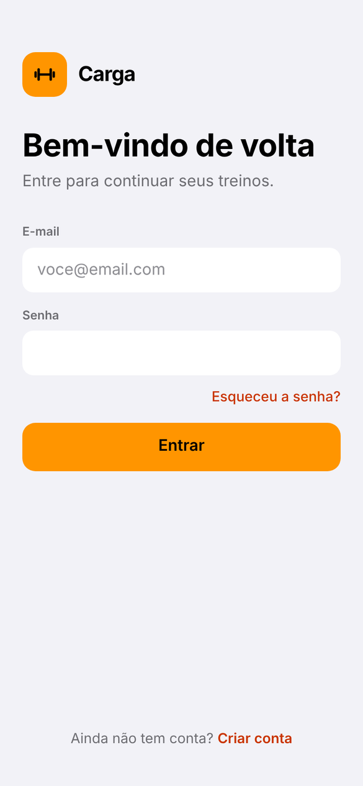 | 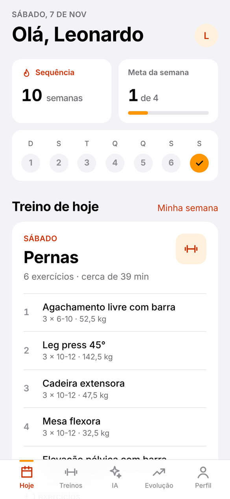 | 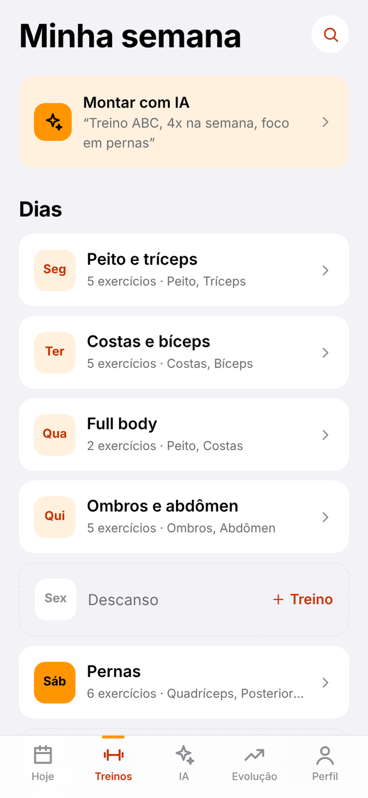 | 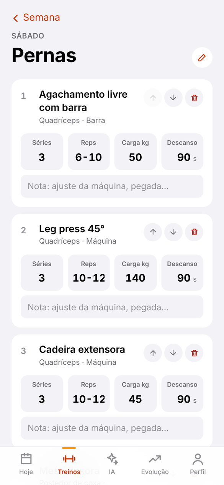 |

| Treino ao vivo | Calculadora de anilhas | Evolução | Perfil |
|:---:|:---:|:---:|:---:|
| 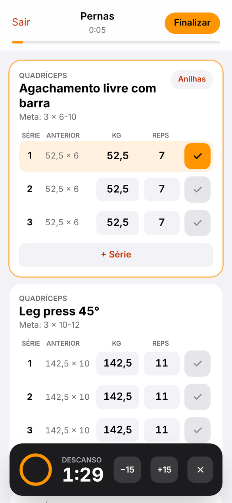 | 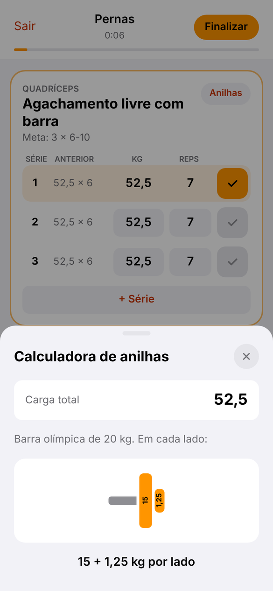 | 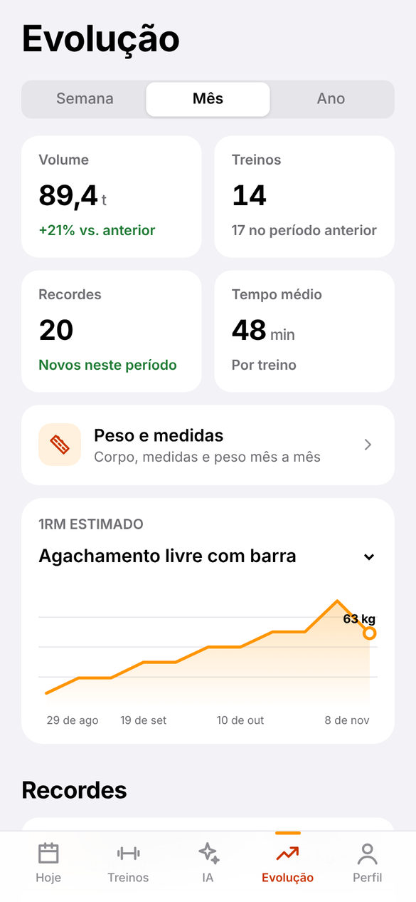 | 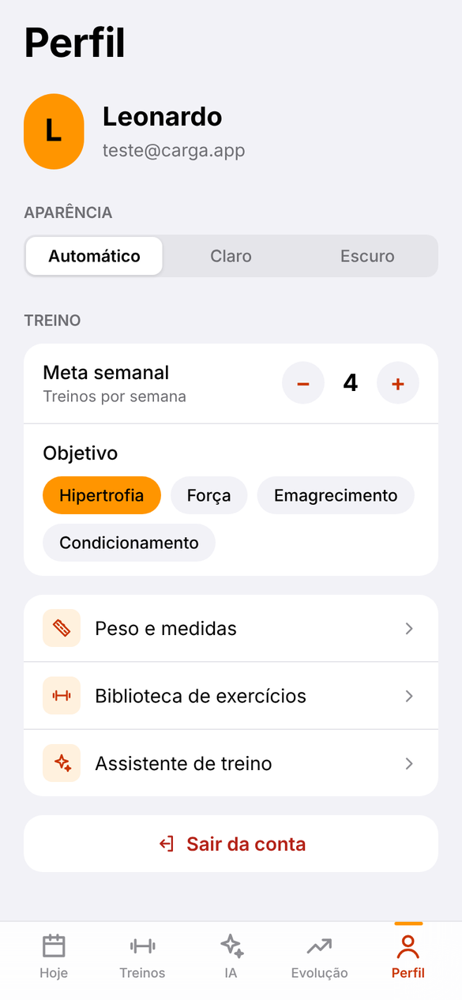 |

| Medidas | Peso | Assistente de IA |
|:---:|:---:|:---:|
| 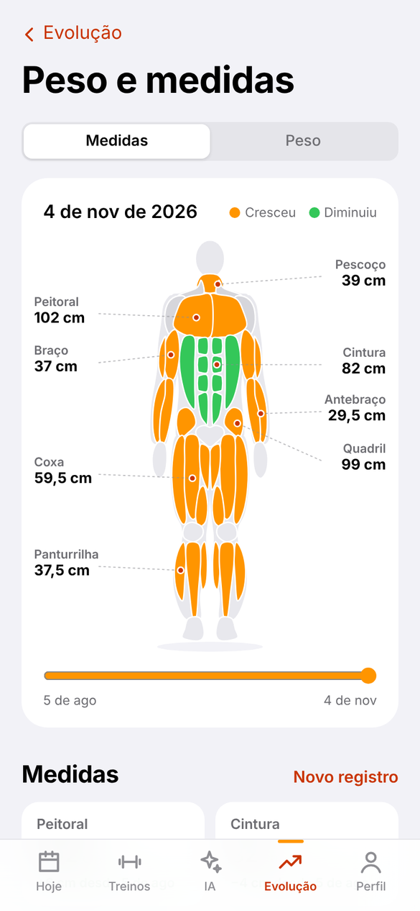 | 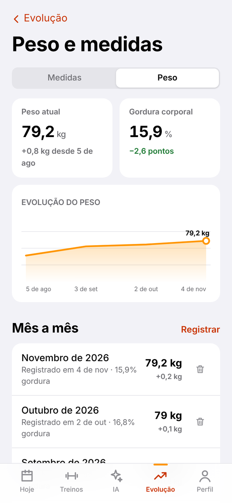 | 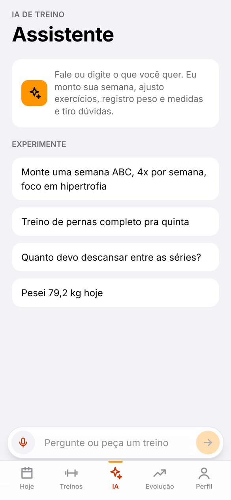 |

### Tema escuro

| Hoje | Treino ao vivo | Evolução | Medidas |
|:---:|:---:|:---:|:---:|
| 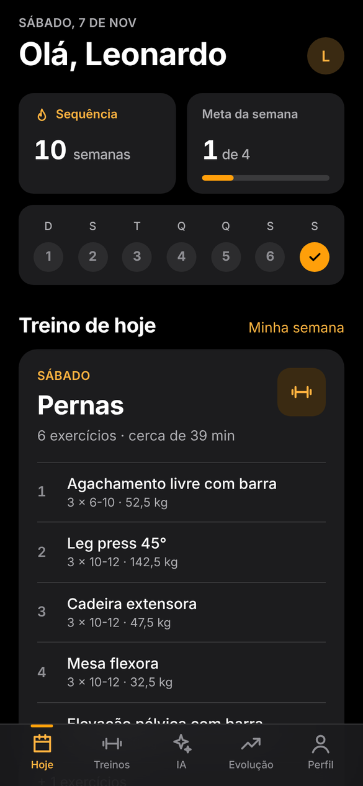 | 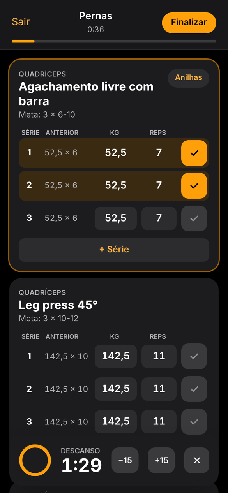 | 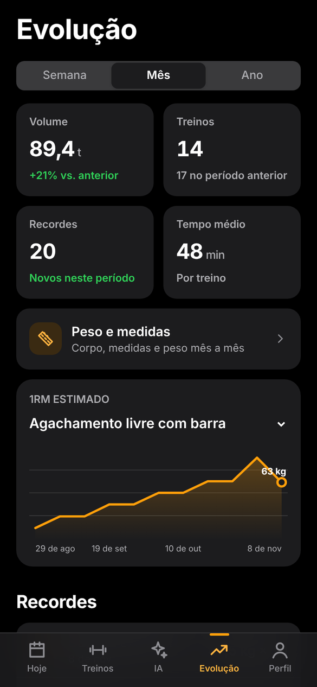 | 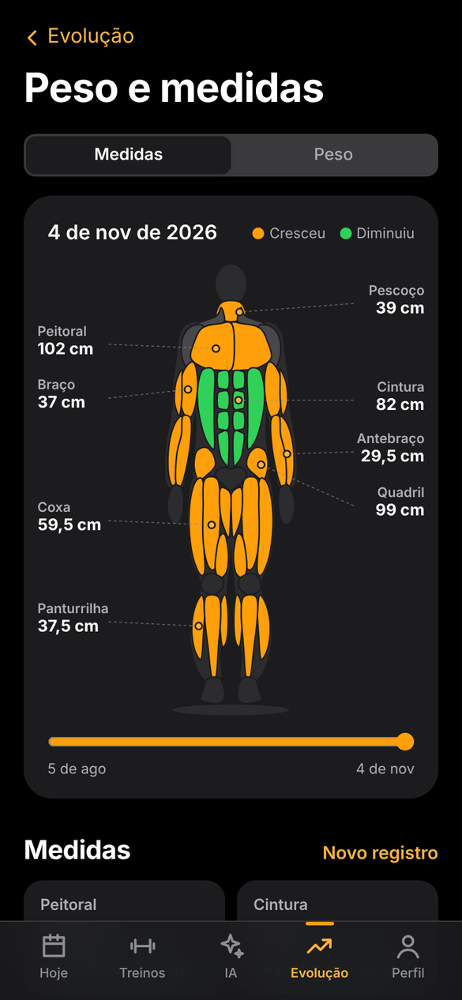 |

## Tecnologias

| Camada | Tecnologia |
| --- | --- |
| Front-end | [Next.js 16](https://nextjs.org/) (App Router), React 19, TypeScript |
| Estilo | Tailwind CSS 4 com variáveis de tema (claro e escuro) |
| Animações | [Motion](https://motion.dev/) (antigo Framer Motion) |
| Back-end | [Supabase](https://supabase.com/): autenticação e PostgreSQL com Row Level Security |
| IA | [Claude API](https://docs.claude.com/) com *tool use* para gravar no banco |
| Gráficos e corpo | SVG feito à mão (sem biblioteca) |

## Como rodar

### Pré-requisitos

- Node.js 20.9 ou superior
- Uma conta no [Supabase](https://supabase.com/) (o plano grátis basta)
- Uma chave da [API da Anthropic](https://console.anthropic.com/) (só para o assistente de IA)

### Passo a passo

```bash
# 1. clonar o repositório
git clone https://github.com/Leonardobrzz/app-treino.git
cd app-treino

# 2. instalar as dependências
npm install

# 3. criar o arquivo de variáveis
cp .env.example .env.local      # no Windows: copy .env.example .env.local

# 4. rodar
npm run dev
```

O app abre em `http://localhost:3000`.

### Variáveis de ambiente

| Variável | Descrição |
| --- | --- |
| `NEXT_PUBLIC_SUPABASE_URL` | URL do projeto no Supabase |
| `NEXT_PUBLIC_SUPABASE_PUBLISHABLE_KEY` | Chave publicável do Supabase (pode ficar no front) |
| `ANTHROPIC_API_KEY` | Chave da API da Anthropic, usada só no servidor |
| `ANTHROPIC_MODEL` | Modelo do Claude (padrão: `claude-sonnet-5-5`) |
| `STRIPE_SECRET_KEY` | Chave secreta do Stripe (`sk_test_...` no modo de teste) |
| `STRIPE_WEBHOOK_SECRET` | Segredo do webhook (`whsec_...`) apontando para `/api/stripe/webhook` |
| `STRIPE_PRICE_MONTHLY` / `STRIPE_PRICE_YEARLY` | IDs dos preços do Carga Pro |
| `SUBSCRIPTION_SYNC_SECRET` | Segredo que autoriza o webhook a gravar a assinatura no banco |
| `NEXT_PUBLIC_STRIPE_TEST` | `1` para mostrar a dica do cartão de teste na tela do Pro |

### Configurando o Supabase do zero

1. Crie um projeto no Supabase.
2. No **SQL Editor**, rode em ordem os arquivos de `supabase/migrations/`:
   - `20261107000001_schema_inicial.sql` → tabelas, índices, RLS e gatilho de perfil
   - `20261107000002_catalogo_exercicios.sql` → catálogo com os 134 exercícios
   - `20261108000003_onboarding.sql` → dados do onboarding no perfil
   - `20261108000004_assinaturas.sql` → assinaturas do Pro (depois, cadastre o segredo em `private.app_secrets`, como explica o arquivo)
   - `20261108000005_ai_messages_hidden.sql` → histórico da IA
3. Em **Authentication → URL Configuration**, configure:
   - **Site URL**: a URL do app publicado
   - **Redirect URLs**: `https://SEU-DOMINIO/auth/confirm` e `http://localhost:3000/auth/confirm`

> ⚠️ O envio de e-mail padrão do Supabase tem um limite baixo por hora. Para produção, configure um SMTP próprio em **Authentication → SMTP**.

## Banco de dados

```
auth.users ──┬── profiles            nome, objetivo, meta semanal
             ├── plans ── plan_days ── plan_exercises ── exercises
             ├── sessions ── session_sets ───────────────┘
             ├── body_weights        peso por data
             ├── body_measurements   8 medidas por data
             ├── checkins            presença na academia
             ├── subscriptions       assinatura do Pro (só o webhook escreve)
             └── ai_messages         histórico do chat com a IA
```

- **exercises**: catálogo global (`created_by = null`) + exercícios criados pelo usuário
- **plans / plan_days / plan_exercises**: a semana de treino (dia da semana → exercícios com séries, reps, carga e descanso)
- **sessions / session_sets**: cada treino realizado e cada série marcada

Todas as tabelas usam **Row Level Security**: cada usuário só consegue ler e alterar os próprios dados, mesmo usando a chave pública direto no navegador.

## Como funciona a progressão de carga

Usei a **dupla progressão**, um método comum em academia:

1. Cada exercício tem uma faixa de repetições, por exemplo `8-12`.
2. Se no último treino **todas as séries** chegaram no topo da faixa (12 reps), o app sugere **aumentar a carga** e voltar para a base da faixa (8 reps).
3. Se não chegou, mantém a carga e sugere tentar 1 repetição a mais.

O incremento depende do equipamento: +1 ou +2 kg em halteres, +2,5 kg na maioria dos exercícios e +5 kg em cargas acima de 100 kg (leg press, por exemplo).

Para comparar força entre treinos com repetições diferentes, o app calcula o **1RM estimado** pela fórmula de Epley:

```
1RM = carga × (1 + repetições / 30)
```

É esse valor que aparece no gráfico de evolução e que decide se uma série foi recorde.

## Estrutura de pastas

```
src/
├── app/
│   ├── (auth)/            login, cadastro, esqueci-senha, nova-senha
│   ├── (app)/             telas com barra inferior
│   │   ├── page.tsx       Hoje
│   │   ├── treinos/       minha semana + edição de cada dia
│   │   ├── exercicios/    biblioteca
│   │   ├── evolucao/      estatísticas e gráficos
│   │   ├── medidas/       peso, medidas e corpo anatômico
│   │   ├── ia/            chat com o assistente
│   │   └── perfil/        meta, objetivo, tema e sair
│   ├── (focus)/treino/    treino ao vivo (tela cheia)
│   ├── api/ia/            rota que conversa com o Claude
│   └── auth/confirm/      retorno dos links de e-mail
├── components/            UI, corpo anatômico (Body), gráfico (LineChart), seletor de exercícios
├── lib/                   cliente Supabase, tipos, lógica de progressão, tema
└── proxy.ts               protege as rotas e renova a sessão
supabase/migrations/       SQL do banco
docs/screenshots/          prints usados neste README
```

## Próximos passos

- [ ] Vista de costas no mapa muscular (dorsal, glúteo, posterior de coxa)
- [ ] Fotos de progresso com comparação lado a lado
- [ ] Check-in automático por localização da academia
- [ ] Modo offline (salvar o treino sem internet e sincronizar depois)
- [ ] Notificação quando o descanso termina com a tela bloqueada
- [ ] Versão nativa com React Native / Expo

## Autor

Feito por **Leonardo Alves Braz**, engenheiro da computação e dev full stack.

[](https://github.com/Leonardobrzz)
