# Carga 🏋️ — App de treino

> Aplicativo web (PWA) para organizar a semana de treinos, registrar as séries na academia, acompanhar a progressão de carga e a evolução do corpo, com um assistente de IA que monta o treino a partir de um pedido em texto ou voz.

🌐 **No ar em [carga.app.br](https://carga.app.br)**: abra no celular e adicione à tela de início.


## Sumário

- [Sobre o projeto](#sobre-o-projeto)
- [Funcionalidades](#funcionalidades)
- [Telas](#telas)
- [Tecnologias](#tecnologias)
- [Como rodar](#como-rodar)
- [Banco de dados](#banco-de-dados)
- [Como funciona a progressão de carga](#como-funciona-a-progressão-de-carga)
- [Estrutura de pastas](#estrutura-de-pastas)
- [Próximos passos](#próximos-passos)
- [Autor](#autor)

---

## Sobre o projeto

A maioria dos apps de academia que eu testei ou é cheia de anúncio, ou não deixa montar o treino do jeito que eu faço, ou não mostra direito se eu estou evoluindo. Então resolvi fazer o meu.

A ideia do **Carga** é ser simples de usar no meio do treino (um toque para marcar a série, o timer de descanso começa sozinho) e, ao mesmo tempo, dar uma visão clara da evolução: quanto a carga subiu, quais recordes foram batidos e como as medidas do corpo mudaram ao longo dos meses.

O visual segue as diretrizes de design da Apple (Human Interface Guidelines): fundo neutro, uma única cor de destaque (laranja) e animações com efeito de mola. Tem tema **claro**, **escuro** e **automático**.

## Funcionalidades

**Conta**
- [x] Cadastro com nome, e-mail e senha
- [x] Login
- [x] "Esqueci minha senha" com link por e-mail e tela para criar uma senha nova
- [x] E-mails de confirmação e de troca de senha em português, enviados pelo domínio próprio (`nao-responda@carga.app.br`, via Resend)
- [x] Páginas de **Termos de uso** e **Política de privacidade** (LGPD), com link no cadastro, no Pro e no Perfil

**Primeiros passos (instalar e aprender a usar)**
- [x] **Guia de instalação** logo depois do cadastro: como o Carga não está na Play Store nem na App Store, o app mostra o passo a passo pra adicionar à tela de início, de acordo com o celular e o navegador (iPhone com Safari ou Chrome, Android com Chrome ou Samsung Internet)
- [x] No Android, botão **Instalar o Carga** que abre a instalação do navegador com um toque, quando o navegador permite
- [x] Detecta quando a pessoa abriu pelo navegador do Instagram (que não instala apps) e ensina a abrir no navegador do celular
- [x] **Tour das funcionalidades**: 9 telas com prints reais do app explicando cada parte; aparece na primeira vez e também na primeira vez que o app instalado é aberto
- [x] No Perfil: **Como usar o Carga** (rever o tour) e **Instalar na tela de início** (some quando o app já está instalado)

**Treinos**
- [x] Montar a própria semana: escolher o dia, dar nome ao treino e adicionar exercícios
- [x] Configurar séries, repetições (ex.: `8-12`), carga, descanso e uma nota por exercício
- [x] Biblioteca com **134 exercícios** em português, com busca e filtro por grupo muscular
- [x] Criar exercícios próprios quando não estão na lista
- [x] **Como fazer**: fotos do início e do fim do movimento alternando (tipo GIF), músculos trabalhados e 3 dicas de execução em português, na biblioteca, no editor do dia e no treino ao vivo (129 dos 134 exercícios têm imagem)
- [x] Reordenar e remover exercícios

**Treino ao vivo**
- [x] Séries já preenchidas com a carga sugerida e o que foi feito no treino anterior
- [x] Timer de descanso automático com vibração ao terminar (−15 s / +15 s / pular)
- [x] Calculadora de anilhas para exercícios com barra
- [x] Resumo no final com volume, séries, tempo e **recordes batidos**
- [x] Dá para sair e continuar o treino depois sem perder o que foi marcado

**Acompanhamento**
- [x] Check-in na academia, sequência de semanas e meta semanal
- [x] Sugestão automática de aumento de carga
- [x] Evolução por semana, mês e ano: volume, treinos, recordes e tempo médio
- [x] Gráfico do **1RM estimado** por exercício
- [x] Séries por grupo muscular na semana, com aviso quando está abaixo do ideal
- [x] Registro de **peso** em qualquer data (dá para lançar meses antigos) e histórico mês a mês
- [x] Registro de **medidas** com um **mapa muscular anatômico** que muda de cor e de tamanho conforme a evolução

**Assistente de IA**
- [x] Chat com o Claude (Anthropic) para tirar dúvidas de treino
- [x] Monta a semana inteira a partir de um pedido como *"treino ABC, 4x por semana, foco em pernas"* e salva no app
- [x] Ajusta um dia específico, registra peso e medidas e consulta o histórico de um exercício
- [x] Entrada por **voz** (Web Speech API, em português)

**Nutrição**
- [x] Diário de alimentação por refeição (café, almoço, lanche e jantar) e controle de água
- [x] Metas de calorias, proteína, carboidrato e gordura calculadas pelo perfil (Mifflin-St Jeor + objetivo) ou personalizadas
- [x] **Foto do prato → calorias**: a IA identifica cada alimento, estima a porção e os macros, e dá pra ajustar antes de salvar (Pro)
- [x] Também dá pra descrever a refeição em texto ou contar pro chat da IA ("almocei arroz, feijão e frango") que ela registra sozinha
- [x] Alimentos recentes com um toque e gráfico dos últimos 7 dias (Pro)

**Diferenciais**
- [x] **Importar ficha da academia**: foto da ficha de papel, do quadro ou print do app da academia → a IA transcreve e vira a sua semana (confere os dias e tira o que não quiser antes de salvar)
- [x] **"Como você está hoje?"** antes do treino: sono, energia e dor. Num dia ruim o app tira 1 série e baixa ~10% da carga; dor no ombro/joelho/lombar/cotovelo marca os exercícios que podem incomodar
- [x] **Máquina ocupada**: troca na hora por um exercício equivalente (mesmo músculo), com carga sugerida pelo histórico, só hoje ou também na semana; ou pula o exercício
- [x] **Card pra story**: no fim do treino gera uma imagem 1080×1920 com volume, séries, tempo, recordes e exercícios, e abre o compartilhar do celular
- [x] **Resumo da semana**: treinos x meta, volume vs semana anterior, recordes, séries por músculo, alimentação e peso, + sugestões da IA pra próxima semana (Pro)
- [x] **Amigos**: link de convite e ranking semanal (treinos, volume, séries). Os amigos só veem esses totais
- [x] **Feed dos amigos**: posta o treino com foto (volume, duração, exercícios e recorde por cima da imagem) ou só foto e texto. Curtir com dois toques, comentários, denunciar e bloquear. É fechado: só você e seus amigos veem. Post com 3 denúncias some sozinho, e as denúncias aparecem no painel do dono
- [x] **Área do personal** (grátis por enquanto): o personal ativa no Perfil e convida alunos por link ou código. Painel com radar (quem sumiu, volume caindo, mensalidade atrasada, plano vencendo, sem anamnese ou reavaliação, quem bateu recorde) e mensagens prontas no WhatsApp. Por aluno: resumo (frequência, cargas de cada treino, peso, medidas), montar e enviar treino com métodos (bi-set, drop, pirâmide, rest-pause…) ou automático pelo perfil do aluno, avaliação física (Pollock 3 e 7 + Siri, perimetria, postural por fotos com grade e linha de prumo, comparação com a anterior), anamnese com PAR-Q, fotos de progresso, relatório em PDF com o nome e CREF do personal e financeiro. Agenda de aulas, cobranças do mês, desafios com ranking entre os alunos e vitrine pública com antes e depois (só com autorização do aluno)
- [x] **Mais ferramentas do personal**: montar a semana com IA lendo anamnese (lesões, PAR-Q) e avaliação (postura, % de gordura), importar a ficha de papel por foto, versões anteriores do treino, PDF da ficha de treino e das orientações alimentares com nome e CREF, metas de alimentação aplicadas no app do aluno, diário alimentar do aluno (o que ele comeu, com calorias e proteína contra a meta), busca de exercício por apelido ("puxada alta", "voador", "stiff"…), relatórios do mês por aluno com aviso todo dia 1 e tela mais larga no computador
- [x] **Lado do aluno do personal**: "Meu personal" com anamnese pra responder, Pix copia e cola e QR Code com o valor (o dinheiro cai direto na chave do personal, sem passar pelo Carga), envio de comprovante, próximas aulas, desafios, avaliação física e controle de privacidade (ranking e vitrine). O treino enviado aparece em Treinos com o método de cada exercício
- [x] **Avisos e push**: sininho no Hoje e notificação no celular (web push) pra treino novo, anamnese, avaliação, cobrança, pagamento confirmado, aula marcada e desafio. Um cron diário (Vercel) gera as mensalidades, lembra cobrança vencendo ou atrasada, plano acabando, aluno sumido e aula do dia seguinte
- [x] **Animações**: confete e números subindo no fim do treino, cards entrando em sequência no Hoje, coração ao curtir, abas com efeito de toque
- [x] **Relatório em PDF** (Pro): escolhe o período (30 dias, 3/6 meses, 1 ano ou datas livres) e gera um PDF de 3 páginas com resumo, destaques, peso, mapa do corpo colorido (laranja cresceu, verde diminuiu) com a tabela de medidas, antes e depois das fotos, força por exercício, recordes, séries por músculo e alimentação. Abre o compartilhar do celular pra mandar pro personal ou nutri
- [x] **Fotos de progresso**: frente, lado e costas, com antes/depois deslizante e a diferença de peso e medidas entre as datas (Pro, armazenamento privado)

**Carga Pro (assinatura)**
- [x] Teste grátis de 7 dias, plano mensal (R$ 19,90) e anual (R$ 99,90) com pagamento pelo **Stripe**
- [x] Grátis: 5 mensagens por mês com a IA. Pro: IA à vontade (uso justo de 300 mensagens por mês), calorias pela foto do prato, importar ficha até 15 vezes por dia, gráfico de força (1RM), evolução do ano inteiro e linha do tempo do corpo
- [x] Portal do cliente para trocar de plano, atualizar o cartão ou cancelar
- [x] Webhook do Stripe sincroniza a assinatura com o banco automaticamente

**Painel do dono (/admin)**
- [x] Só abre para os e-mails cadastrados em `private.app_admins` (os números vêm de funções do banco que recusam qualquer outro usuário)
- [x] Usuários (total, na semana, hoje), receita por mês, quem treinou nos últimos 7 dias e custo estimado da IA no mês
- [x] Gráfico de cadastros dos últimos 30 dias, planos (grátis, teste, mensal, anual, cancelando, atrasado) e o funil do cadastro ao pagamento
- [x] Lista de usuários com busca e filtro por plano, último acesso, treinos e avisos ("não confirmou o e-mail", "não terminou a configuração")

## Telas

### Primeiros passos

| Instalar no iPhone | Instalar no Android | Veio do Instagram |
|:---:|:---:|:---:|
| 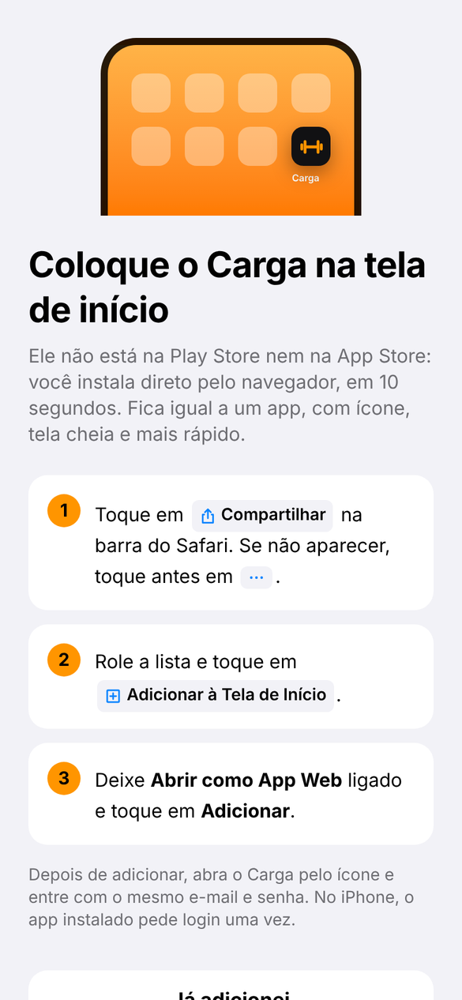 | 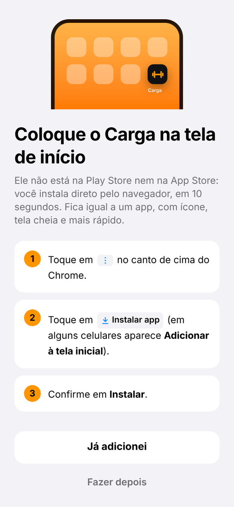 | 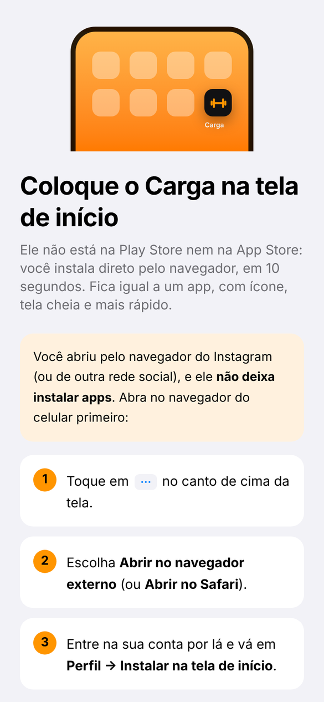 |

| Tour: Hoje | Tour: treino que se adapta |
|:---:|:---:|
| 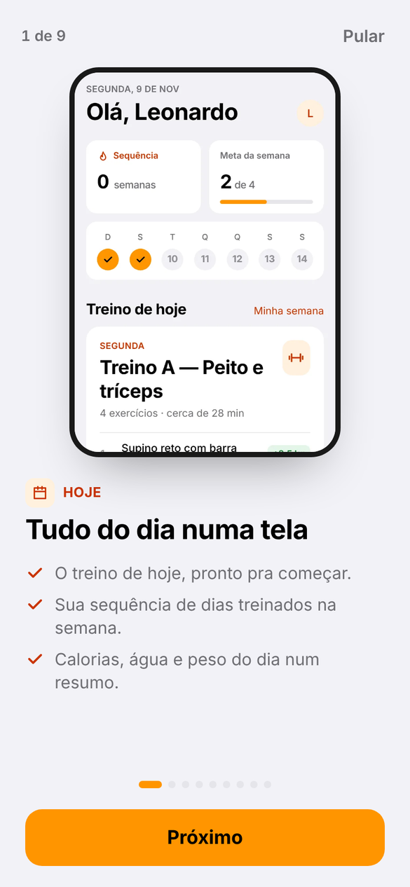 | 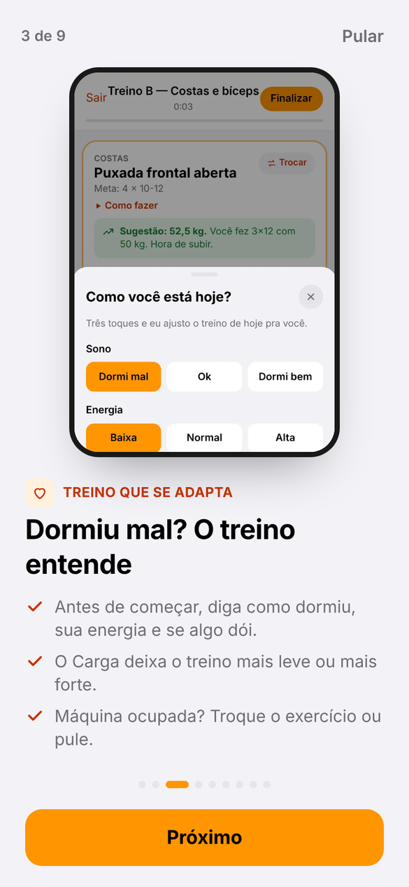 |

### Dentro do app

| Login | Hoje | Minha semana | Editar treino |
|:---:|:---:|:---:|:---:|
|  |  |  |  |

| Treino ao vivo | Calculadora de anilhas | Evolução |
|:---:|:---:|:---:|
|  |  |  |

| Medidas | Peso | Assistente de IA |
|:---:|:---:|:---:|
|  |  |  |

| Importar ficha | Dia mais leve | Máquina ocupada |
|:---:|:---:|:---:|
| 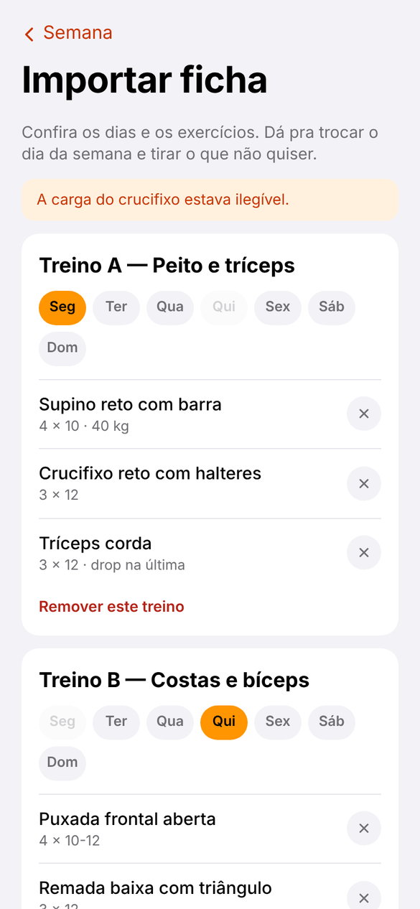 | 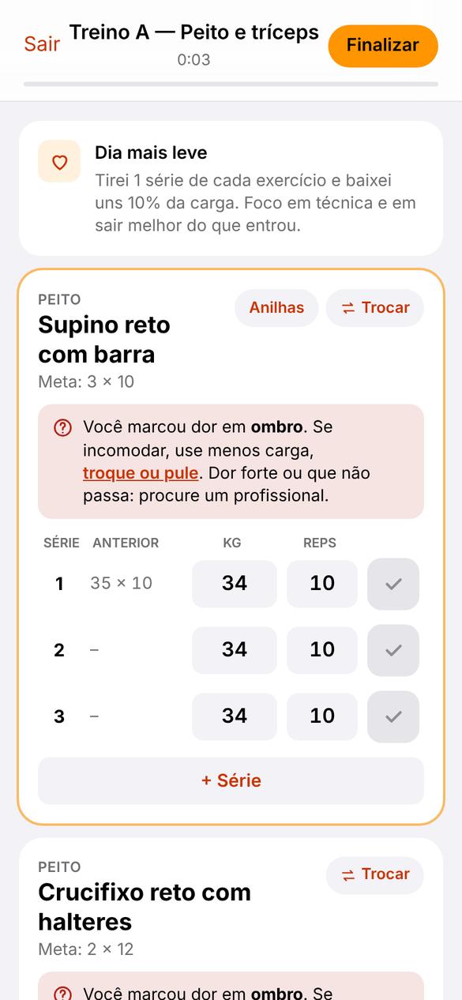 | 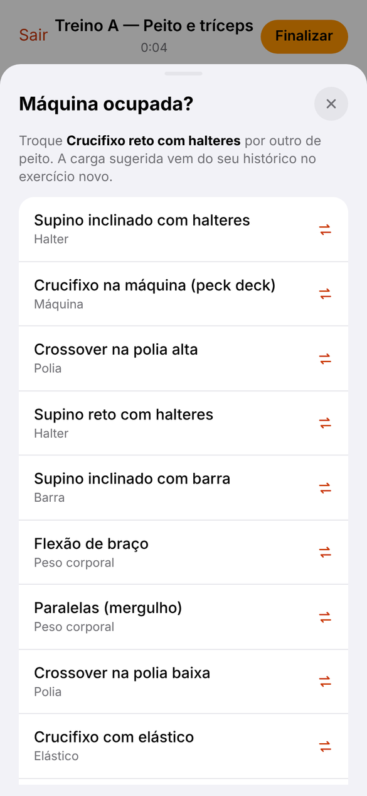 |

| Como fazer | Termos de uso | Perfil |
|:---:|:---:|:---:|
| 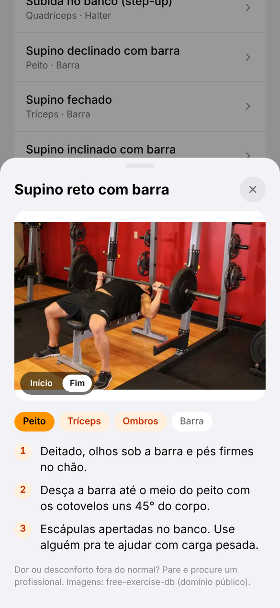 | 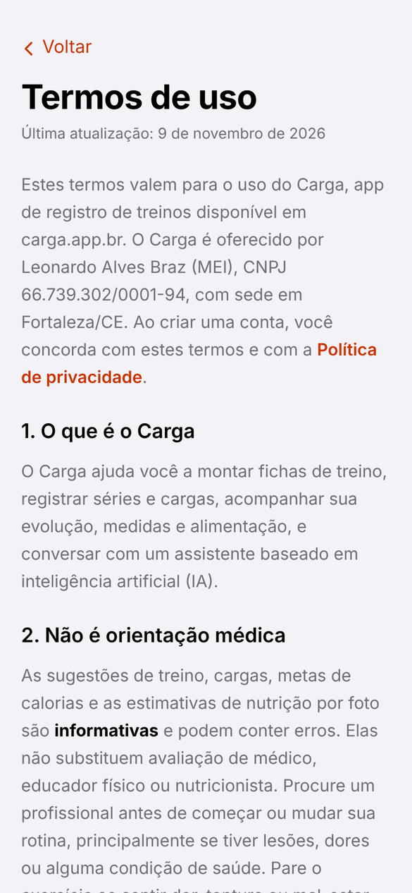 |  |

| Resumo da semana | Amigos | Card pro story |
|:---:|:---:|:---:|
| 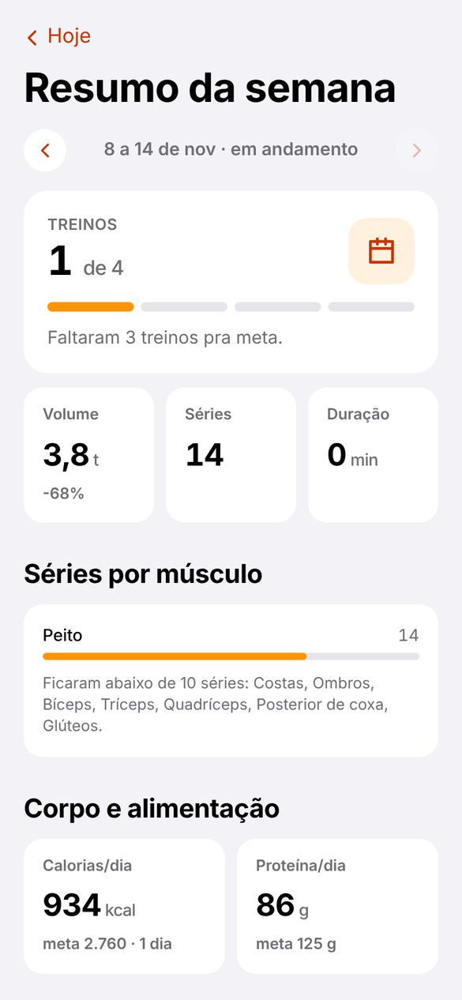 | 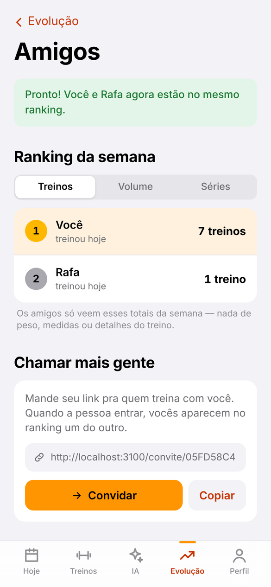 | 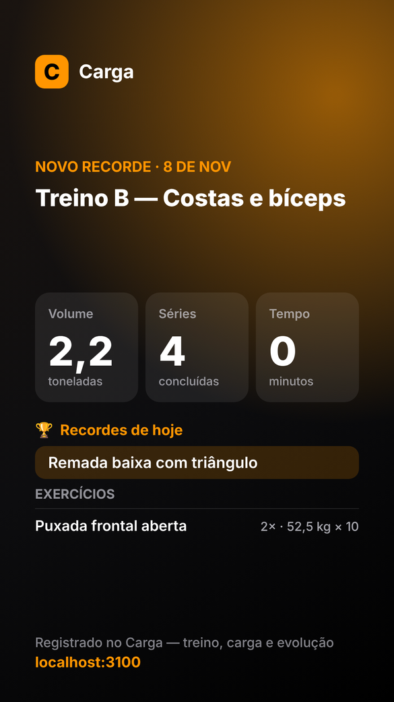 |

| Nutrição | Foto do prato analisada | Nutrição (escuro) |
|:---:|:---:|:---:|
| 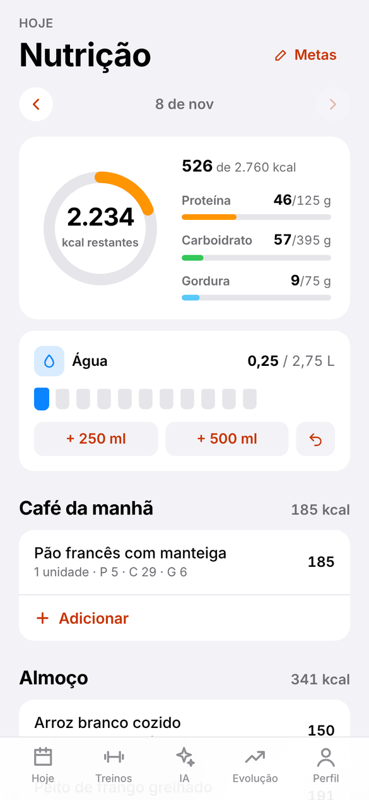 | 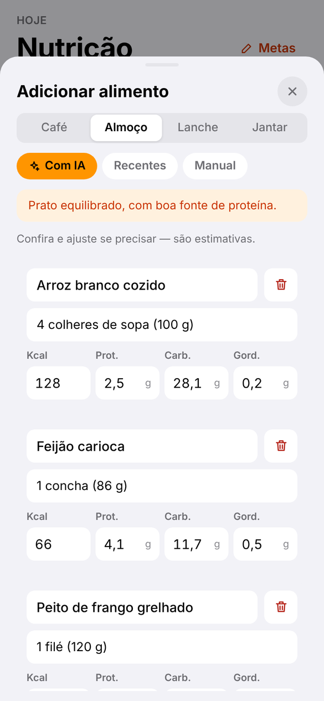 | 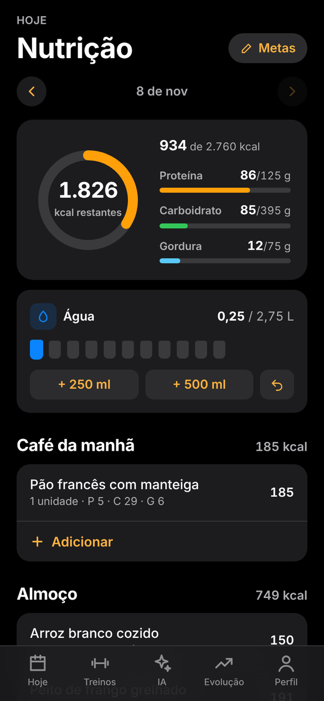 |

### Tema escuro

| Hoje | Treino ao vivo | Evolução | Medidas |
|:---:|:---:|:---:|:---:|
|  |  |  |  |

## Tecnologias

| Camada | Tecnologia |
| --- | --- |
| Front-end | [Next.js 16](https://nextjs.org/) (App Router), React 19, TypeScript |
| Estilo | Tailwind CSS 4 com variáveis de tema (claro e escuro) |
| Animações | [Motion](https://motion.dev/) (antigo Framer Motion) |
| Back-end | [Supabase](https://supabase.com/): autenticação e PostgreSQL com Row Level Security |
| IA | [Claude API](https://docs.claude.com/) com *tool use* para gravar no banco e *prompt caching*. Sonnet no Pro e em tudo que lê imagem; Haiku no chat do plano grátis (mais barato) |
| Pagamentos | [Stripe](https://stripe.com/) (Checkout, portal do cliente e webhook) |
| E-mail | [Resend](https://resend.com/) como SMTP do Supabase, no domínio próprio |
| Hospedagem | [Vercel](https://vercel.com/) + domínio `carga.app.br` (Registro.br) |
| Gráficos e corpo | SVG feito à mão (sem biblioteca) |

## Como rodar

### Pré-requisitos

- Node.js 20.9 ou superior
- Uma conta no [Supabase](https://supabase.com/) (o plano grátis basta)
- Uma chave da [API da Anthropic](https://console.anthropic.com/) (só para o assistente de IA)

### Passo a passo

```bash
# 1. clonar o repositório
git clone https://github.com/Leonardobrzz/app-treino.git
cd app-treino

# 2. instalar as dependências
npm install

# 3. criar o arquivo de variáveis
cp .env.example .env.local      # no Windows: copy .env.example .env.local

# 4. rodar
npm run dev
```

O app abre em `http://localhost:3000`.

### Variáveis de ambiente

| Variável | Descrição |
| --- | --- |
| `NEXT_PUBLIC_SUPABASE_URL` | URL do projeto no Supabase |
| `NEXT_PUBLIC_SUPABASE_PUBLISHABLE_KEY` | Chave publicável do Supabase (pode ficar no front) |
| `ANTHROPIC_API_KEY` | Chave da API da Anthropic, usada só no servidor |
| `ANTHROPIC_MODEL` | Modelo do Claude no Pro e nas funções com imagem (padrão: `claude-sonnet-5-5`) |
| `ANTHROPIC_MODEL_FREE` | Modelo do chat no plano grátis (padrão: `claude-haiku-5-5`) |
| `STRIPE_SECRET_KEY` | Chave secreta do Stripe (`sk_test_...` no modo de teste) |
| `STRIPE_WEBHOOK_SECRET` | Segredo do webhook (`whsec_...`) apontando para `/api/stripe/webhook` |
| `STRIPE_PRICE_MONTHLY` / `STRIPE_PRICE_YEARLY` | IDs dos preços do Carga Pro |
| `SUBSCRIPTION_SYNC_SECRET` | Segredo que autoriza o webhook a gravar a assinatura no banco |
| `NEXT_PUBLIC_STRIPE_TEST` | `1` para mostrar a dica do cartão de teste na tela do Pro |
| `NEXT_PUBLIC_VAPID_PUBLIC_KEY` / `VAPID_PRIVATE_KEY` | Chaves do web push (`npx web-push generate-vapid-keys`) |
| `VAPID_SUBJECT` | Contato do push (`mailto:...`) |
| `CRON_SECRET` | Autoriza o cron diário `/api/cron/lembretes` (a Vercel manda sozinha); o mesmo valor fica em `private.app_secrets` com a chave `cron` |

### Configurando o Supabase do zero

1. Crie um projeto no Supabase.
2. No **SQL Editor**, rode em ordem os arquivos de `supabase/migrations/`:
   - `20261107000001_schema_inicial.sql` → tabelas, índices, RLS e gatilho de perfil
   - `20261107000002_catalogo_exercicios.sql` → catálogo com os 134 exercícios
   - `20261108000003_onboarding.sql` → dados do onboarding no perfil
   - `20261108000004_assinaturas.sql` → assinaturas do Pro (depois, cadastre o segredo em `private.app_secrets`, como explica o arquivo)
   - `20261108000005_ai_messages_hidden.sql` → histórico da IA
   - `20261108000006_nutricao.sql` → refeições, água e metas de nutrição
   - `20261108000007_social_prontidao_fotos.sql` → prontidão do treino, amigos e ranking, resumo semanal e fotos de progresso
   - `20261110000008_painel_admin.sql` → painel do dono (troque os e-mails da lista `private.app_admins` pelos seus)
3. Em **Authentication → URL Configuration**, configure:
   - **Site URL**: a URL do app publicado (aqui, `https://carga.app.br`)
   - **Redirect URLs**: `https://SEU-DOMINIO/**` e `http://localhost:3000/**`
4. Em **Authentication → Emails → SMTP Settings**, ligue o SMTP próprio. Com o Resend: host `smtp.resend.com`, porta `465`, usuário `resend` e uma API key do Resend como senha. O domínio precisa estar verificado no Resend (registros DKIM e SPF no DNS).
5. Em **Authentication → Emails → Templates**, use links no formato `{{ .SiteURL }}/auth/confirm?token_hash={{ .TokenHash }}&type=email&next=/` (e `type=recovery` no de senha). Assim o link funciona mesmo se a pessoa abrir o e-mail em outro aparelho ou navegador.

> ⚠️ O envio de e-mail padrão do Supabase tem um limite baixo por hora. Para produção, use um SMTP próprio, como no passo 4.

## Banco de dados

```
auth.users ──┬── profiles            nome, objetivo, meta semanal
             ├── plans ── plan_days ── plan_exercises ── exercises
             ├── sessions ── session_sets ───────────────┘
             ├── body_weights        peso por data
             ├── body_measurements   8 medidas por data
             ├── checkins            presença na academia
             ├── meals               alimentos por refeição e dia (kcal e macros)
             ├── water_logs          copos de água
             ├── nutrition_scans     uso da análise por foto (limite diário)
             ├── friendships         amizades (criadas só pela função add_friend)
             ├── progress_photos     fotos de progresso (arquivos no bucket privado "progresso")
             ├── weekly_reports      sugestões da IA do resumo semanal
             ├── ai_usage            uso das funções de IA com limite
             ├── subscriptions       assinatura do Pro (só o webhook escreve)
             └── ai_messages         histórico do chat com a IA
```

- **exercises**: catálogo global (`created_by = null`) + exercícios criados pelo usuário
- **plans / plan_days / plan_exercises**: a semana de treino (dia da semana → exercícios com séries, reps, carga e descanso)
- **sessions / session_sets**: cada treino realizado e cada série marcada

Todas as tabelas usam **Row Level Security**: cada usuário só consegue ler e alterar os próprios dados, mesmo usando a chave pública direto no navegador.

## Como funciona a progressão de carga

Usei a **dupla progressão**, um método comum em academia:

1. Cada exercício tem uma faixa de repetições, por exemplo `8-12`.
2. Se no último treino **todas as séries** chegaram no topo da faixa (12 reps), o app sugere **aumentar a carga** e voltar para a base da faixa (8 reps).
3. Se não chegou, mantém a carga e sugere tentar 1 repetição a mais.

O incremento depende do equipamento: +1 ou +2 kg em halteres, +2,5 kg na maioria dos exercícios e +5 kg em cargas acima de 100 kg (leg press, por exemplo).

Para comparar força entre treinos com repetições diferentes, o app calcula o **1RM estimado** pela fórmula de Epley:

```
1RM = carga × (1 + repetições / 30)
```

É esse valor que aparece no gráfico de evolução e que decide se uma série foi recorde.

## Estrutura de pastas

```
src/
├── app/
│   ├── (auth)/            login, cadastro, esqueci-senha, nova-senha
│   ├── (app)/             telas com barra inferior
│   │   ├── page.tsx       Hoje
│   │   ├── treinos/       minha semana + edição de cada dia
│   │   ├── exercicios/    biblioteca
│   │   ├── evolucao/      estatísticas e gráficos
│   │   ├── medidas/       peso, medidas e corpo anatômico
│   │   ├── nutricao/      diário alimentar, água e metas
│   │   ├── importar/      importar ficha da academia
│   │   ├── resumo/        resumo da semana
│   │   ├── amigos/        convite e ranking semanal
│   │   ├── feed/          feed dos amigos e novo post
│   │   ├── personal/      área do personal (painel, alunos, aluno/[id], agenda, cobranças, desafios, relatórios, perfil)
│   │   ├── meu-personal/  lado do aluno (Pix, comprovante, anamnese)
│   │   ├── avisos/        avisos e ativar notificações
│   │   ├── fotos/         fotos de progresso (antes e depois)
│   │   ├── ia/            chat com o assistente
│   │   ├── admin/         painel do dono (números do app)
│   │   ├── relatorio/     relatório em PDF do período
│   │   └── perfil/        meta, objetivo, tema e sair
│   ├── (focus)/treino/    treino ao vivo (tela cheia)
│   ├── (focus)/pro/       planos e assinatura
│   ├── (intro)/           comecar (instalação + tour na primeira vez), como-usar, instalar
│   ├── (legal)/           termos de uso e política de privacidade
│   ├── api/ia/            rota que conversa com o Claude
│   ├── api/nutricao/      análise de foto/texto da refeição com o Claude
│   ├── api/importar/      leitura da ficha da academia com o Claude
│   ├── api/resumo/        sugestões da semana com o Claude
│   └── auth/confirm/      retorno dos links de e-mail
├── components/            UI, corpo anatômico (Body), gráfico (LineChart), seletor de exercícios, guia de instalação e tour
├── lib/                   cliente Supabase, tipos, lógica de progressão, tema, detecção de instalação (install.ts), modelos de IA (ai-models.ts)
└── proxy.ts               protege as rotas e renova a sessão
supabase/migrations/       SQL do banco
public/tour/               prints do tour dentro do app
docs/screenshots/          prints usados neste README
```

## Próximos passos

- [ ] Vista de costas no mapa muscular (dorsal, glúteo, posterior de coxa)
- [ ] Versão para personal trainer (acompanhar alunos e cobrar por aluno)
- [ ] Notificação do resumo da semana no domingo
- [ ] Check-in automático por localização da academia
- [ ] Modo offline (salvar o treino sem internet e sincronizar depois)
- [ ] Notificação quando o descanso termina com a tela bloqueada
- [ ] Versão nativa com React Native / Expo (e publicar na Play Store e na App Store)
- [ ] Botão de excluir conta direto no Perfil

## Créditos

- Fotos dos exercícios: [free-exercise-db](https://github.com/yuhonas/free-exercise-db), em domínio público (Unlicense). As dicas de execução em português foram escritas para o Carga.

## Autor

Feito por **Leonardo Alves Braz**, engenheiro da computação e dev full stack.

[](https://github.com/Leonardobrzz)
